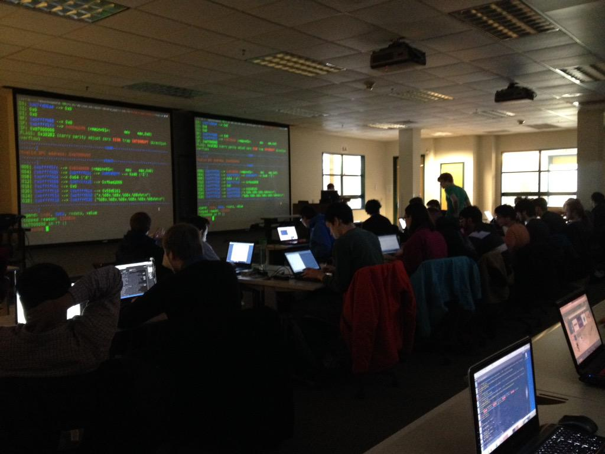
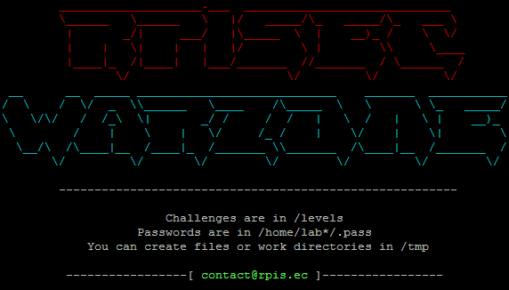
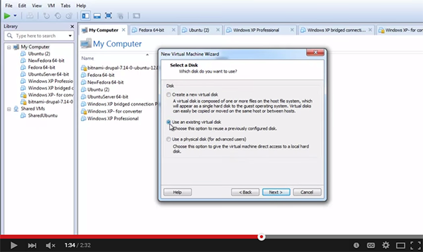
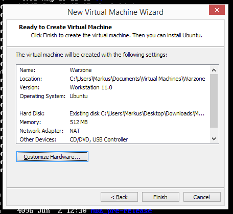
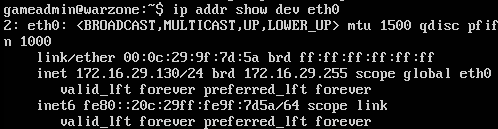

> **これは日本語訳です。**
>
> - 原著: [RPISEC/MBE](https://github.com/RPISEC/MBE)(原著者: RPISEC)
> - ライセンス: BSD-2-Clause — 翻訳も同じライセンスです([ライセンス全文](LICENSE))。原文から翻訳(変更)しています
> - 訳した範囲: README・ERRATA・課題コードのコメントと説明文(コードは原著のまま)
> - 訳していないもの: 講義スライド(原著のリポジトリに含まれていません)。出題の挙動やヒントが変わる文字列は訳していません
> - 他の日本語訳: [一覧](https://github.com/orgs/0xFF-MinusOne/repositories?q=-ja)

# Modern Binary Exploitation - CSCI 4968
このリポジトリには、[RPISEC](http://rpis.ec) が 2015 年春に [Rensselaer Polytechnic Institute](http://rpi.edu) で
Modern Binary Exploitation (現代的なバイナリエクスプロイト) を教えるために作成し、使用した教材が入っています。
これは、脆弱性調査(vulnerability research)、リバースエンジニアリング(reverse engineering)、バイナリエクスプロイト(binary exploitation)の
技術を教えるために、学生だけで開発・運営された大学の講義でした。

<p align="center">

</p>

## 講義について

脆弱性調査とエクスプロイト開発(exploit development)は、通常の計算機科学のカリキュラムではまず扱われません。
しかし、私たち RPISEC のメンバーが空き時間に取り組んでいることの多くは、まさにこの分野です。
また、攻撃的セキュリティ(offensive security)の話題は、大学ではどこか敬遠されがちだと感じており、
その偏見を払いたいとも考えています。これらは実践的で応用的な技術であり、学びたい人と喜んで共有したいと思っています。

この講義が掲げた問いは、_「プログラマーの集団に pwn のやり方を教えられるだろうか?」_ でした。

**講義のウェブサイト:** [http://security.cs.rpi.edu/courses/binexp-spring2015/](https://web.archive.org/web/20210710080726/http://security.cs.rpi.edu/courses/binexp-spring2015/)

**シラバス:** [http://security.cs.rpi.edu/courses/binexp-spring2015/Syllabus.pdf](https://web.archive.org/web/20210413214448/http://security.cs.rpi.edu/courses/binexp-spring2015/Syllabus.pdf)

### 講義の概要

>_サイバーセキュリティは計算機科学の中でも最も急速に成長している分野の一つですが、発展の速さと技術的な専門性の高さから、学術の場で扱われることはほとんどありません。Modern Binary Exploitation では、バイナリエクスプロイトとリバースエンジニアリングにおける、実践的な攻撃的セキュリティの技術を教えることに重点を置きます。対話形式の講義、実践的なラボ、業界からのゲストスピーカーを組み合わせることで、急速に変化するセキュリティ分野の中でも特に技術的に踏み込んだ、魅力的なテーマを探求する貴重な機会を学生に提供します。_

>_講義は、x86 の基本的なリバースエンジニアリング、脆弱性解析(vulnerability analysis)、そして Linux ベースのユーザーランド(userland)における古典的なバイナリエクスプロイトから始めます。続いて、現代のシステムに備わっている防御機構(カナリア(Canaries)、DEP、ASLR、RELRO、Fortify Source など)と、それらを破る技術に進みます。時間が許せば、カーネルランド(kernel-land)や Windows ベースのエクスプロイトなど、エクスプロイトに関するその他のテーマも扱います。_

### 前提知識
この講義の履修には、RPI の
[Computer Organization - CSCI 2500](http://catalog.rpi.edu/preview_course_nopop.php?catoid=10&coid=16571)
が前提条件になっていました。Computer Organization は RPI の計算機アーキテクチャの基礎課程で、
C、MIPS アセンブリ、x86 アセンブリ、データパス(Datapaths)、CPU パイプライン(CPU Pipelining)、
CPU キャッシュ(CPU Caching)、メモリマッピング(Memory Mapping)などを教えます。

Modern Binary Exploitation が想定していた受講者は、リバースエンジニアリングやバイナリエクスプロイトの知識がまったくない学生でした。
とはいえ、この講義を受けるには、少なくとも次のスキルが必要でしょう。
* C/C++ を実務レベルで扱えること
* アセンブリレベルの経験(種類は問いません)
* Linux のコマンドラインの基本的な経験

### 講義の内訳
講義 | タイトル | トピック
------- | ----- | ------
01 | シラバスと復習 | Linux, C, x86
02 | リバースエンジニアリング入門 | ツールと VM
03 | リバースエンジニアリング応用 | GDB & IDA
04 | メモリ破壊入門 | ELF、スタック、呼び出し規約(calling convention)、バッファオーバーフロー(buffer overflow)
05 | シェルコード作成 / コードインジェクション | シェルコード(shellcode)の作成、状況に合わせたペイロード(payload)の開発
06 | 書式文字列の脆弱性 | 書式文字列(format string)、DTOR/GOT の上書き
07 | DEP と ROP | データ実行防止(Data Execution Prevention)、ROP チェーンの作成、ret2libc
08 | セキュアなシステムとゲーム機のエクスプロイト | OpenBSD, SELinux, GRSEC, ゲーム機のエクスプロイト
09 | アドレス空間配置のランダム化 (ASLR) | 概要、情報リーク(info leak)、部分上書き(partial overwrite)、ASLR の終焉
10 | ヒープのエクスプロイト | ヒープの構造と概念、ヒープ破壊、解放後使用(use after free)
11 | その他の概念とスタッククッキー | 符号あり/なしの問題、未初期化データ(uninitialized data)など、スタッククッキー(stack cookie)の回避
12 | C++ の違いと概念 | C++ の基本、構造体、vTable、例外
13 | Linux カーネルのエクスプロイト | カーネルの基礎、カーネルエクスプロイト、緩和策(mitigation)(mmap_min_addr, kallsyms, SMEP/SMAP)、緩和策の回避
14 | 64bit、ARM、Windows でのエクスプロイト | 他のアーキテクチャやプラットフォームでのエクスプロイトの違い
15 | 自動化とエクスプロイトの未来 | ファジング(fuzzing)、汚染解析(taint analysis)、動的計装(dynamic instrumentation)、SMT/SAT ソルバー

*スライドの訂正は [ERRATA.md](https://github.com/RPISEC/MBE/blob/master/ERRATA.md) を参照してください。*

### ラボの内訳
ラボ | トピック | 対応する講義
--- | ----- | ----------------------
[01](/src/lab01) | リバースエンジニアリング | 01-03
[02](/src/lab02) | メモリ破壊 | 04
[03](/src/lab03) | シェルコード作成 | 05
[04](/src/lab04) | 書式文字列 | 06
[P1](/src/project1) | プロジェクト 1 | 01-06 (総合)
[05](/src/lab05) | DEP と ROP | 07
**XX** | **これ以降は ASLR を常に有効にしてください** | **詳細は「VM の情報」を参照**
[06](/src/lab06) | ASLR | 09
[07](/src/lab07) | ヒープ | 10
[08](/src/lab08) | その他とスタッククッキー | 11
[09](/src/lab09) | C++ | 12
[P2](/src/project2) | プロジェクト 2 | 01-12 (総合)
[10](/src/lab10) | Linux カーネル | 13

### リポジトリの構成
* [src/](/src) - ラボのソースコード
* [setup_wargame.sh](/setup_wargame.sh),[external_tools.sh](/external_tools.sh) - Ubuntu 14.04 32 ビットのマシンに MBE をセットアップするインストールスクリプト
* [MBE_release.tar.gz](https://github.com/RPISEC/MBE/releases/download/v1.1_release/MBE_release.tar.gz) - ラボとプロジェクトのバイナリ
* [MBE_lectures.tar.gz](https://github.com/RPISEC/MBE/releases/download/v1.1_release/MBE_lectures.tar.gz) - 全講義スライドの PDF
* [MBE_VM.vmdk.gz](https://github.com/RPISEC/MBE/releases/download/v1.1_release/MBE_VM.vmdk.gz) - セットアップ済みの VM の vmdk (ディスクイメージ)

## ラボ - RPISEC Warzone

Warzone は、この講義のために一から作られたオリジナルのウォーゲーム(wargame)です。
ラボとプロジェクトを学生に公開するための、完結した一貫性のある学習プラットフォームとして機能しました。
このウォーゲームは、素の Ubuntu 14.04 32 ビットサーバーのインストールの上に構築されており、
既存のローカル権限昇格(local privilege escalation)をテーマにしたウォーゲームを手本にしています。
素晴らしい [IO wargame](https://io.netgarage.org/) (以前は SmashTheStack でホストされていました)を遊んだことがあれば、
Warzone はそれとよく似た構造だと感じるでしょう。

<p align="center">

</p>

プレイヤー同士を隔離して個別の体験にするために基本的な調整を加えていますが、完璧にはほど遠いと思います。
また、エクスプロイト開発で初心者が少し楽になるように、ツール、スクリプト、設定ファイルをあらかじめインストールしてあります。

私たちが設計した Warzone をそのまま使ってもよいですし、私たちのスクリプトを使って自分で構築してもかまいません。
___
### 方法 1 - 作成済みの Warzone VM
年月が経つにつれて、コンパイラは変わり、セキュリティは向上し、このリポジトリの課題は解けなくなるかもしれません。
そのため、講義の期間中に運用していた共通の Warzone ウォーゲームサーバーをできるだけ忠実に再現した、
仮想マシンのディスクイメージを作成しました。この VM には、すべてのツールがセットアップされ、課題はコンパイル済みで、
ラボ用のアカウントもすぐ使える状態になっています。時の試練に耐えてくれることを願っています。

#### 仮想マシンのセットアップ

RPISEC は品質と安定性の点で VMware を強く支持しているため、下記のディスクイメージは
VMware Workstation、VMware Fusion、VMware Player で使うことをお勧めします。
ただし、VirtualBox でも動作するはずです。

VMware は、既存のディスクイメージを使って仮想マシンをセットアップする方法を説明した、優れた [2 分の動画](https://www.youtube.com/watch?v=I6WfFLQwoPg)を公開しています。

<p align="center">
<a href="https://www.youtube.com/watch?v=I6WfFLQwoPg"></a>
</p>

1. リリースページから [MBE_VM.vmdk.gz](https://github.com/RPISEC/MBE/releases/download/v1.1_release/MBE_VM.vmdk.gz) をダウンロードします
2. アーカイブを展開して、ディスクイメージを取り出します
3. VMware で `File->New Virtual Machine...` を開き、カスタム VM (Custom VM) を作成します
4. `Guest Operating System Installation` を尋ねられたら、`I will install the operating system later` を選びます
5. ほとんどの質問はデフォルトの選択肢のままで構いません。スペックは次のとおりをお勧めします:
  * プロセッサ / コア 1 つ
  * RAM 512 MB
  * NAT ネットワーク
6. `Select a Disk` を尋ねられたら、`Use an existing virtual disk` を選び、展開した .vmdk を指定します
7. 最終的な画面は次のようになるはずです。Finish をクリックして、VM を起動します。

<p align="center">

</p>


#### 遊び方
講義はできるだけこれだけで完結するようにしましたが、行き詰まったときは [OverTheWire の Bandit](http://overthewire.org/wargames/bandit/) が Linux ウォーゲームの良い入門になります。質問があれば [IRC](#contact) で声をかけることもできます。
* SSH は VM にあらかじめ設定されていますが、IP アドレスが必要です。まず、VMWare または VirtualBox のコンソールからログインします。IP アドレスを調べるには、次のように入力します。<br>
  ```$ ip addr```<br>
  <p align="center">
  
  </p>
  そして、[PuTTY](http://the.earth.li/~sgtatham/putty/latest/x86/putty.exe) またはコマンドラインのクライアントで SSH 接続します。<br>
  <code>$ ssh lab1C@172.16.29.130</code><br>
  <code>lab1C@172.16.130's password: lab01start</code><br>
* `/levels/labXX` に移動して始めます。<br>
  ```$ cd /levels/lab01```
* Warzone は、一般的なローカル権限昇格のウォーゲームと同じ構造です。
課題をエクスプロイトして権限を昇格し、別のユーザー(レベル)にアクセスします。
レベルをエクスプロイトして次のユーザーに昇格したら(`whoami` で確認します)、そのユーザーのホームディレクトリからパスワードを読み取ります。<br>
  ```$ cat /home/lab1B/.pass```
* 新しいユーザー名とパスワードで SSH 接続して、先に進みましょう!

#### VM の情報
* 管理者ユーザー: `gameadmin:gameadmin`
* 講義用ユーザー: `lecture:lecture`
* rc ファイルは `/etc/cfg` にあります
  * すべてのラボ/プロジェクトのユーザーのホームディレクトリに、これらのファイルへのシンボリックリンクがあります
  * これらのファイルは `/etc/skel` にもシンボリックリンクされています
* ラボを始めるには、`labXC:lab0Xstart` でログインします
  * 例: `lab1C:lab01start`
  * プロジェクトは `projectX:projectXstart` です
* レベルは `/levels` にあります
* パスワードは `/home/$USER/.pass` にあります
* ツールは `/tools` と `/usr/local/bin` にインストールされています
* **DEP/ROP のラボを終えたら ASLR を有効にし、講義の最後まで有効のままにしてください**
  * 再起動まで有効: ```# echo 2 > /proc/sys/kernel/randomize_va_space```
  * 再起動後も維持: ```# echo 'kernel.randomize_va_space = 2' > /etc/sysctl.d/01-disable-aslr.conf```

___
### 方法 2 - 独自の Warzone を作る
提供している VM とまったく同じ環境を完全にセットアップする bash スクリプトを用意しています。

**このスクリプトを個人のコンピューターで実行しないでください。仮想マシンの中で実行してください**

1. [MBE_release.tar.gz](https://github.com/RPISEC/MBE/releases/download/v1.1_release/MBE_release.tar.gz) をダウンロードします
2. アーカイブを VM またはマシンに移動して展開します <br>
  **注意: スティッキービット(sticky bit)がワイルドカードの動作を狂わせることがあるため、/tmp からスクリプトを実行することはお勧めしません** <br>
  ```$ tar xzvf MBE_release.tar.gz```
3. [setup_wargame.sh](/setup_wargame.sh) の先頭にある設定用の変数を、必要に応じて書き換えます
4. セットアップスクリプトに実行権限を付け、sudo で実行します<br>
  ```$ chmod +x ./setup_wargame.sh```<br>```$ sudo ./setup_wargame.sh```<br>
インターネット接続の速度と Ubuntu のアップデートの数にもよりますが、完了するまでに 10〜20 分ほどかかります。

## よくある質問

#### lab1c にログインできないのはなぜですか?
アカウント名は大文字と小文字が区別されます。lab1**C** でログインしているか確認してください。

#### 'permission denied' エラーが出るのはなぜですか?
Warzone では、ユーザーがファイルを変更して他のプレイヤーのゲームを台無しにするのを防ぐため、多くのファイルにイミュータブル属性(immutable)を設定しています。
たとえば、lab2B ユーザーに自分の `.pass` ファイルや `/levels` 配下のファイルを削除されては困ります。
`/etc/passwd` など一部のシステムファイルにも、同じ属性が設定されています。

これらのファイルを変更または削除したい場合は、イミュータブル属性を外すだけです。
```bash
chattr -i filename
```
変更が終わったら、属性を付け直すことをお勧めします。
```bash
chattr +i filename
```

#### ラボの解答はどこにありますか?
解答を公開すると、ゲームの楽しさや地道に取り組む面白さが損なわれます。また、学術的な教材として、これらの資料が将来ほかの講義で再利用される可能性もあります。
多くのウォーゲームと同じく、ラボやプロジェクトの解説記事(writeup)やエクスプロイトを公開で投稿するのは控えてください。

問題で行き詰まったときや質問があるときは、遠慮なく [IRC](#contact) で聞いてください。

#### XYZ の講義スライドの内容が薄いのはなぜですか?
この講義は実践中心だったため、ほぼ毎回、学生が GDB のコマンドを打ったり、画面上で私たちの操作に付いてきたりしていました。
スライドは講義の補助であり、抜けがあったり簡潔すぎたりすることがあります。
7 人で講義を作って担当したため、スライドや教え方には多少のばらつきがあります。できるだけ統一するようにしました。

#### 講義の動画はありますか?
残念ながら、講義は一つも録画していません。次の機会にはやるかもしれません。

#### 学生にラボのソースコードを渡すのはなぜですか?
私たちはリバースエンジニアリングや CTF の課題が大好きですが、リバースエンジニアリングは結局のところ時間の問題です。
学期中、学生は他の授業やアルバイトを掛け持ちしています。そのため、すべてのバイナリをリバースエンジニアリングする負担なしに、
エクスプロイトの技術を学ぶことに集中してほしいと考えました。

#### この課題は本当に簡単ですが、どういうことですか?
履修した 50 人の学生には、コンピューターセキュリティの経験がほとんど、またはまったくありませんでした。
ラボは目新しい CTF の課題として作ったものではなく、概念を定着させるペースで進められる、より学術的な例題として作ったものです。
CTF に慣れた人なら、これらの課題のほとんどを一日か二日で突破できるでしょう。

#### XYZ のテーマを扱わなかったのはなぜですか?
XYZ が脆弱性調査に関係するものなら、ぜひ聞かせてください。この講義は完璧にはほど遠く、改善のためのフィードバックを歓迎します。

#### この講義は RPI で再び開講されますか?
再び開講してほしいという声が多く、2016 年春の開講を検討しています。
学生からの感想はほぼ好意的で、内容は難しいが引き込まれるというものでした。次回さらに良くするためのアイデアも何十個もあります。

#### もっと学ぶにはどうすればよいですか?
ほかのウォーゲームで遊んでみてください。
* [SmashTheStack IO](http://io.smashthestack.org/)
* [Pwnable KR](http://pwnable.kr/)
* [OverTheWire](http://overthewire.org/wargames/)
* [Reversing KR](http://reversing.kr/)
* [W3Challs](http://w3challs.com/)

そして、開催されているときは [CTF](https://ctftime.org/) にも参加しましょう!

#### <a name="contact"></a>質問があります。どうすれば連絡できますか?
私たちのクラブは [IRC](http://rpis.ec/irc) でかなり活発に活動しています。そこにいる誰かが、おそらく質問に答えてくれます。

**サーバー:** `irc.rpis.ec`
**ポート:** `6667`、または `6697` (SSL)


より正式な連絡手段をご希望の場合は、`contact [at] rpis.ec` までご連絡ください。


# ライセンス
この講義は、学術・教育目的での利用のみを明確に想定して設計されました。教材を共有・配布するときは、この点に留意してください。
適用されるライセンスの詳細は、以下のとおりです。

**講義スライド**

講義は、クリエイティブ・コモンズ 表示-非営利 4.0 国際ライセンス
(Creative Commons Attribution-NonCommercial 4.0 International license) [CC BY-NC 4.0](https://creativecommons.org/licenses/by-nc/4.0/legalcode).
<p align="center">
<a href="https://creativecommons.org/licenses/by-nc/4.0/"></a>
</p>

**コード**

このリポジトリのコードは BSD 2-Clause ライセンスの対象です。ライセンスの全文は [LICENSE](/LICENSE) で確認できます。

# 謝辞
この講義の制作と運営には、何百時間もの作業と数え切れない徹夜が費やされました。
この節では、それを可能にしてくれた方々への感謝を記します。

## 原著者
  * Patrick Biernat
  * Jeremy Blackthorne
  * Alexei Bulazel
  * Branden Clark
  * Sophia D'Antoine
  * Markus Gaasedelen
  * Austin Ralls

## 特別な謝辞
  * この機会を与え、自由にやらせてくれた [RPI CS Department](http://www.cs.rpi.edu/)
  * このような講義を後援してくださった Bülent Yener 教授
  * 一学期のあいだ私たちに付き合ってくれた学生のみなさん
